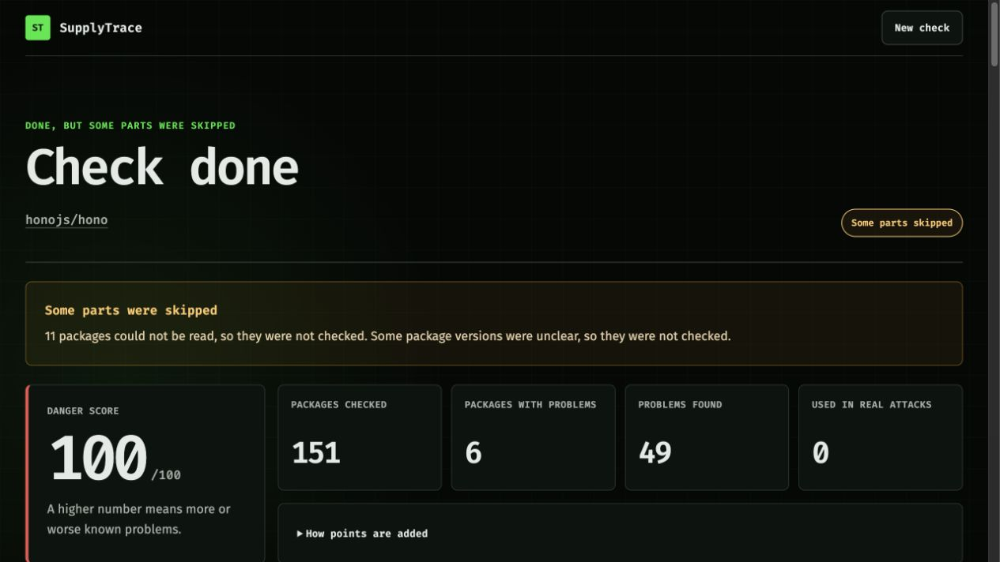
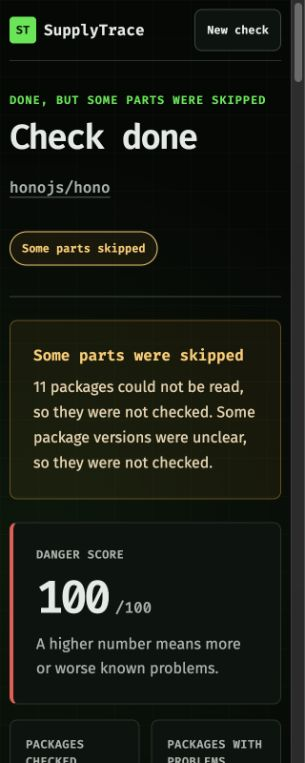
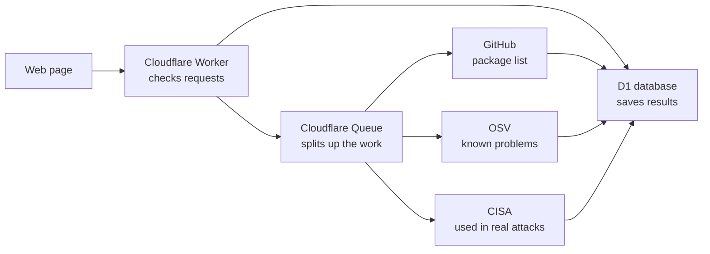

# SupplyTrace

[](https://github.com/haportech/supplytrace-web/actions/workflows/ci.yml)

SupplyTrace checks the small pieces of code used by a public GitHub project. These pieces are called packages. It shows known safety problems, safer versions, and links to the full reports.

The public website is an example only. It has no GitHub key and cannot start a live check. To check a project, run SupplyTrace on your computer with your own key.

[View the code](https://github.com/haportech/supplytrace-web)

## Screenshots

| Desktop | Phone |
| --- | --- |
|  |  |

## What it does

When you run it on your own computer, SupplyTrace:

- Accepts one public GitHub project link.
- Reads the package list supplied by GitHub.
- Checks exact package versions against OSV, a public list of known problems.
- Checks whether a problem is on CISA's list of problems used in real attacks.
- Shows a danger score, package map, link table, safer versions, and full reports.
- Clearly says when a package or data source could not be checked.
- Reuses a recent result to save free daily use.

An empty result does not prove that a project is safe. It only means that SupplyTrace did not find a match in the public lists it checked.

## How it works



The web page uses React. A Cloudflare Worker runs the server code. D1 is the small SQL database. A Queue breaks each check into small jobs so it can stay inside the free Worker limits.

## Built with

- React and TypeScript for the web page.
- Hono for the API, which is the part the page uses to talk to the server.
- Cloudflare Workers for the server.
- Cloudflare D1 for saved results.
- Cloudflare Queues for background jobs.
- GitHub's package list, OSV, and CISA KEV for public safety data.
- Vitest and Playwright for code and browser checks.

## Live-check limits

These limits apply when live checks are turned on in a local or private copy. The public website does not start live checks.

| Limit | Amount |
| --- | ---: |
| New checks for the whole site | 20 each day |
| New checks from one visitor | 3 each hour |
| Time before a recent result is checked again | 6 hours |
| Packages checked in one project | 200 |
| Package links saved | 400 |
| Problems saved | 600 |
| Time a result is kept | 30 days |

A result says “Some parts were skipped” when one of these limits is reached or a package version is unclear.

## Run it on your computer

You need Node.js 22 or newer.

```bash
git clone https://github.com/haportech/supplytrace-web.git
cd supplytrace-web
npm ci
npm run db:migrate:local
cp .dev.vars.example .dev.vars
```

Open `.dev.vars` and replace `your_key_here` with your own GitHub key. Then run:

```bash
npm run dev
```

Open [http://localhost:5173](http://localhost:5173).

Live checks turn on only when your local `.dev.vars` file has your key:

```text
GITHUB_TOKEN=your_key_here
```

`.dev.vars` is ignored by Git and must never be committed.

## Check the code

Install the test browser once:

```bash
npx playwright install chromium
```

Run every check:

```bash
npm run verify
```

This checks types, code style, unit tests, Worker and database tests, the production build, package safety, and 13 full browser flows. GitHub Actions runs the same checks for every pull request and every push to `main`.

To see the code coverage report:

```bash
npm run test:coverage
```

## Deploy on Cloudflare

The app needs a free Cloudflare account. The D1 database and Queue must be created once.

```bash
npx wrangler login
npx wrangler d1 create supplytrace-db --location apac
npx wrangler queues create supplytrace-scans
```

Copy your D1 `database_id` into `wrangler.jsonc`, replacing the existing value. Then run:

```bash
npm run db:migrate:remote
npm run deploy
```

Do not add a personal `GITHUB_TOKEN` to a public Worker. With no GitHub key on Cloudflare, the hosted page stays an example and live requests are blocked.

## Safety choices

- Only links in the form `https://github.com/owner/project` are accepted.
- The public Worker has no GitHub key and blocks new live checks.
- Queued work is removed without a GitHub request when no key is present.
- The website never asks visitors to enter a key.
- The server builds its own GitHub API address after checking the link.
- Only public projects are supported.
- When a GitHub key is present, the server confirms the project is public before reading its package list.
- No account, email address, or name is collected.
- A visitor's network address is changed into a one-way private code before it is used for hourly limits.
- Request bodies stop at 1 KB.
- Outside data requests stop after 15 seconds and have size limits.
- Outside error pages and private server details are never sent to the browser.
- Report links must use HTTPS and are limited to six per problem.
- Browser safety headers block framing, cameras, microphones, location access, and code from other sites.
- Results are removed after 30 days during normal use.

## Danger score

The score is simple and can be checked by hand:

| Danger level | Points |
| --- | ---: |
| Very high | 10 |
| High | 6 |
| Medium | 3 |
| Low or not rated | 1 |
| Used in a known real attack | 15 extra |

The final score stops at 100. It helps sort results; it is not a promise that one project is safer than another.

## Main folders

```text
src/client/       web page
src/server/       API, data checks, jobs, and database code
src/shared/       data shapes used by both sides
migrations/       D1 database setup
test/             unit, API, Worker, and database checks
e2e/              full browser checks
docs/             screenshots
```

## Common problems

**“GitHub does not have a package list”**

The project may not exist, may be private, or may not have GitHub's package list turned on.

**“GitHub is busy”**

Wait a few minutes. Make sure your own key is set in your local `.dev.vars` file.

**The local database tables are missing**

```bash
npm run db:migrate:local
```

**Wrangler says the D1 database cannot be found**

Create the database, then replace the existing `database_id` in `wrangler.jsonc` with the ID Wrangler prints.

**Browser checks cannot find Chromium**

```bash
npx playwright install chromium
```

## Known limits

- Private GitHub projects are not supported.
- A GitHub package list can contain a version range instead of one exact version. SupplyTrace shows that package but skips its problem check.
- Results depend on the current GitHub, OSV, and CISA data. New or unlisted problems will not appear.
- The package map shows the first 24 useful packages. The link table shows every saved link.
- The public website uses built-in example data and makes no live GitHub check.
